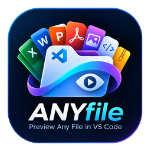
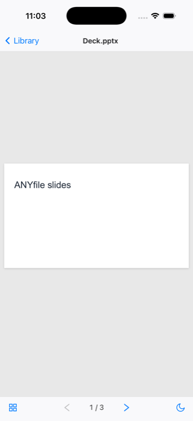
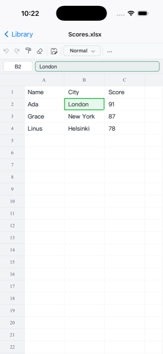

<p align="center">
  
</p>

# ANYfile

Made by Paras Chhugani · X: [@paras_chhugani](https://x.com/paras_chhugani)

ANYfile opens PDFs, spreadsheets, Word documents, slides, e-books and more: in **VS Code** on the Mac, and in an **iPhone and iPad app**. Keep your files in iCloud Drive and a PDF opens at the same page, with the same highlights, on every device.

> **I modified this extension to fit my use case.** Thank you to [cweijan/vscode-office](https://github.com/cweijan/vscode-office) (Office Viewer by Weijan Chen, MIT License). ANYfile is built on their work.

## VS Code extension

What I changed:

- **PDF highlighting:** select text in a PDF to highlight it. Highlighting is on by default, and the toolbar has a toggle and five colors. Highlights are saved into the PDF file as standard annotations, so other PDF readers show them too. Click a highlight to remove it, or press Ctrl/Cmd+Z to undo the last one.
- **Remembers your page inside the PDF:** the last page you were on is saved in the file itself (as a custom document property), so it follows the PDF to your other devices with no limit on how many files are remembered. Turn it off with the `vscode-office.pdf.rememberPositionInFile` setting.
- **Local-only:** it runs as its own extension (`paras-chhugani.anyfile`), installed from a `.vsix`, so the Marketplace never updates or replaces it.
- **New name and icon.**

To install: `npx @vscode/vsce package --no-dependencies`, then `code --install-extension anyfile-4.2.4.vsix`.

## iPhone and iPad app

<p align="center">
  
  
  
</p>

The same viewers as the extension, as an iOS app in [`mobile/`](mobile/README.md). Open files from iCloud Drive or any folder in the Files app; they are opened in place, so iCloud keeps every device in sync.

| Files | In the app |
|---|---|
| PDF | Read, highlight (long-press text, then tap **Highlight**), pinch to zoom. The page you're on and your highlights are saved inside the PDF, so VS Code and the app open it at the same place. |
| Excel, CSV | View, with sheet tabs and Find |
| Word | View; the page fits the screen, pinch to zoom |
| PowerPoint | View; swipe between slides, thumbnails in a drawer |
| EPUB | Read; swipe or tap the sides to turn pages |
| Fonts, Parquet | View |
| Images, HEIC | Shown by iOS's own Quick Look |

Everything except PDFs is view-only for now. The app follows the system's light and dark mode.

**How it's built:** the viewers are the extension's own code (PDF.js with the highlighting and page memory, and the React viewers), running in a [Capacitor](https://capacitorjs.com) app. One small Swift file opens and saves files with iCloud-safe file coordination; if another device changed a PDF in the meantime, the app re-reads it and applies its change again instead of overwriting.

**Run it** (needs a Mac with Xcode and Node.js):

```bash
cd mobile
npm install
npm run ios      # builds it and runs it in an iOS simulator
```

To install it on your own iPhone or iPad, see [mobile/README.md](mobile/README.md).

## Office Viewer features

The rest of this README describes the original Office Viewer features, which all still work in the extension.

## Introduction

This extension lets you preview and edit common office and design files directly in VS Code.

- Excel: `.xls`, `.xlsx`, `.xlsm`, `.csv`, `.ods`
- Word: `.docx`, `.dotx`
- PowerPoint: `.pptx`, `.pptm`
- PDF & eBook: `.pdf`, `.epub`
- HEIC/TIFF: `.heic`, `.heif`, `.tiff`
- Design: `.psd`, `.xmind`, `.icns`, `.svg`
- Font: `.ttf`, `.otf`, `.woff`, `.woff2`
- Markdown: `.md`, `.markdown`
- HTML: `.html`, `.htm`
- HTTP request: `.http`, `.rest`
- Java: `.class` (decompiler)
- Compressed files: `.zip`, `.jar`, `.vsix`, `.rar`, `.7z`, `.tar`, `.tar.gz`, `.tgz`, `.apk`

## Git History

Office Viewer includes a full Git History workspace for exploring repositories without leaving VS Code. Open it from the Source Control view, the editor title bar, the editor context menu, or the file explorer context menu.


## Markdown

This extension replaces the default Markdown editor with a WYSIWYG editor.

To use the built-in VS Code Markdown editor instead, add this to your `settings.json`:

```json
{
    "workbench.editorAssociations": {
        "*.md": "default",
        "*.markdown": "default"
    }
}
```

Right-click in the editor to export Markdown to PDF, DOCX, or HTML. PDF export requires Chromium; set the browser path with `vscode-office.chromiumPath`.


Shortcuts: Based on [shortcut.md](shortcut.md), plus:

- New line: `Ctrl+Enter` / `⌘ Enter`
- Hard line break: `Shift+Enter` / `⇧ Enter`
- Edit hyperlink: `Alt+Enter` / `^ Enter`
- Set CodeMirror language: `Alt+Enter` / `^ Enter`
- Edit in VS Code: `Ctrl Alt E` / `⌘ ^ E`
- Paste as plain text: `Ctrl+Shift+V` / `⌘ ⇧ V`

## Other features

- HTML: live preview while editing; press `Ctrl+Shift+V` to open the live view
- YAML: document outline and anchor navigation (Go to Definition for alias references)
- Icon theme: includes a subset of [Material Icon Theme](https://github.com/PKief/vscode-material-icon-theme) icons, plus **Office Material Icon Theme** and **One Dark Modern** color themes
- Excel: preview and save `.xlsx`, `.xls`, `.xlsm`, `.csv`, and `.ods` files
- HTTP: send requests from `.http` and `.rest` files (integrated from [REST Client](https://github.com/Huachao/vscode-restclient) with fixes for local request issues); press `Ctrl+Enter` / `⌘ Enter` to send
- Java: decompile and view `.class` files

## Development Guide

### Prerequisites

- [Node.js](https://nodejs.org/) 18+
- [VS Code](https://code.visualstudio.com/) 1.64+

### Getting started

```bash
git clone https://github.com/paraschhugani/ANYfile.git
cd ANYfile
npm install
```

### Development

**Desktop extension** (full feature set):

```bash
npm run dev
```

Press `F5` in VS Code, or choose **Extension** from Run and Debug.

**Web extension** (Markdown, HTML, YAML in the browser):

```bash
npm run dev:web
```

Choose **Extension (Web)** from Run and Debug.

### Build & package

```bash
npm run build    # production build
npm run package  # create .vsix
```

## Usage data

Office Viewer collects **anonymous usage data** to understand which preview features are used, so we can improve the extension. Data is sent to [Azure Application Insights](https://learn.microsoft.com/azure/azure-monitor/app/app-insights-overview) via the official [`@vscode/extension-telemetry`](https://www.npmjs.com/package/@vscode/extension-telemetry) module.

### What we collect

| Event         | When                              | Properties                                                                                                 |
| ------------- | --------------------------------- | ---------------------------------------------------------------------------------------------------------- |
| `view.open` | A custom preview/editor is opened | `viewType` (e.g. `excel`, `markdown`, `pdf`), `fileType` (extension only, e.g. `xlsx`, `md`) |

We **do not** collect file paths, file names, URLs, repository names, request contents, or other personally identifiable information.

### How to opt out

Telemetry is sent only when **both** of the following allow it:

1. VS Code global telemetry is enabled (`telemetry.telemetryLevel` is not `off`, or `telemetry.enableTelemetry` is `true` on older versions).
2. Extension telemetry is enabled: set `vscode-office.enableTelemetry` to `false` in Settings.

You can also disable all VS Code telemetry in **Settings → Application → Telemetry**.

### Maintainer setup

If you build and publish this extension yourself, see [docs/telemetry.md](docs/telemetry.md) for Azure Application Insights setup and sample queries.

## Credits

- PDF rendering: [mozilla/pdf.js](https://github.com/mozilla/pdf.js/)
- DOCX rendering: [VolodymyrBaydalka/docxjs](https://github.com/VolodymyrBaydalka/docxjs)
- PPTX rendering: [pptxviewjs](https://www.npmjs.com/package/pptxviewjs)
- XLSX rendering:
  - [SheetJS/sheetjs](https://github.com/SheetJS/sheetjs): XLSX parsing
  - [myliang/x-spreadsheet](https://github.com/myliang/x-spreadsheet): XLSX rendering
- EPUB: [futurepress/epub.js](https://github.com/futurepress/epub.js)
- PSD: [ag-psd](https://github.com/Agamnentzar/ag-psd)
- XMind: [mind-elixir](https://github.com/ssshooter/mind-elixir-core), [@mind-elixir/import-xmind](https://github.com/ssshooter/mind-elixir-core)
- HEIC conversion: [heic2any](https://github.com/alexcorvi/heic2any)
- Java decompiler: [JetBrains/java-decompiler](https://github.com/JetBrains/intellij-community/tree/master/plugins/java-decompiler/engine)
- HTTP: [REST Client](https://github.com/Huachao/vscode-restclient)
- Markdown: [Vanessa219/vditor](https://github.com/Vanessa219/vditor)
- Material Icon theme: [PKief/vscode-material-icon-theme](https://github.com/PKief/vscode-material-icon-theme)
